# Gesällprov: Connect 5
## Alexander Herder, alhe5785

## Sammanfattning
Detta är ett enkelt Connect 5-spel (5-i-rad-spel) med både singleplayer- och multiplayerfunktionalitet.
I singleplayer-läget spelas spelet mot en AI som använder sig av minimaxalgoritmen för att
kunna välja bästa draget. I multiplayer-läget kan en spelare starta en "game session" (spelsession).
Varje session kan ha max två spelare, och ett Connect 5-spel kan bara startas om två spelare är anslutna till samma session.
Som spelare kan man också ansluta till någon annans redan startade session genom att skriva in en room code (rumskod) som sessionsstartaren
får utskriven som terminaloutput när en session startas. För att en session ska kunna startas behövs en serverklass köras först, vilket
finns i detta projekt också.


*Hur konsolloutputen ser ut för spelare 2 när en multiplayer-match startar.*


*Hur konsolloutputen ser ut när en spelare och en AI möter varandra.*

## Funktion

### Start
Programmet körs helt i terminalen. För multiplayer måste servern startas först (`server.Server`), som sedan lyssnar på port 8000 och skriver ut `Server running on port 8000.`:

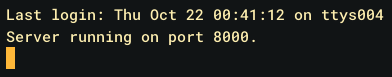

*Servern har startats och väntar på klienter.*

Efter det startar varje spelare en egen klient (`client.Game`). Klienten frågar direkt om man vill spela mot en annan spelare eller inte:

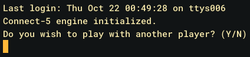

*Startfrågan som visas när klienten startas.*

Svarar man `Y` startas multiplayer-läget och klienten ansluter till servern. Svarar man `N` startas singleplayer-läget mot AI:n, och då används ingen server alls.

### Skapa och gå med i en match
I multiplayer-läget väljer spelaren mellan `CREATE` och `JOIN`. Skriver man något annat får man ett felmeddelande och kan försöka igen. Den som skriver `CREATE` blir spelare 1 och får en rumskod på sex bokstäver utskriven. Den koden skickar man till den andra spelaren, som skriver `JOIN` och sedan koden. När spelare 2 har anslutit får båda spelarna meddelandet `Player 2 joined.` och matchen startar direkt. Bilden under Sammanfattning visar hur det ser ut för spelare 2 efter att ha gått med i ett rum: bekräftelsen, det tomma brädet och väntemeddelandet medan spelare 1 gör sitt första drag.

Om rumskoden inte finns, eller om rummet redan har två spelare, svarar servern med ett felmeddelande och klienten avslutas:

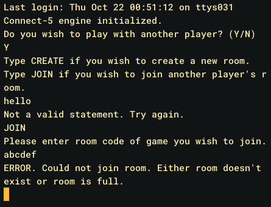

*Ett ogiltigt kommando följt av ett JOIN till ett rum som inte finns.*

### Ett drag
Brädet är 8×8 och skrivs ut med rad- och kolumnnummer. Spelare 1 är `X` och spelare 2 är `O`, och spelare 1 börjar alltid. Den spelare som har turen får skriva in rad och kolumn var för sig, medan den andra ser `Waiting for other player to make their move...`. Draget kontrolleras först lokalt hos klienten: ligger det utanför brädet eller på en redan upptagen ruta får spelaren ett felmeddelande och får försöka igen, utan att något skickas till servern.

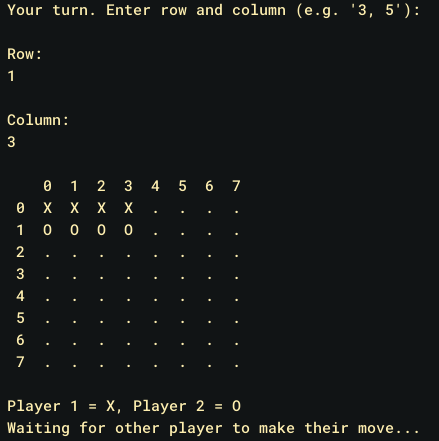

*Spelare 2 har just lagt sin pjäs på rad 1, kolumn 3. Brädet har uppdaterats och spelare 2 väntar nu på spelare 1:s drag.*

När ett giltigt drag har skickats uppdaterar servern sitt bräde och skickar det nya brädet till båda spelarna. Därför ser båda samma bräde efter varje drag, och turen går över till den andra spelaren.

### Vinst och oavgjort
Efter varje drag kontrollerar servern om någon har fem i rad, vågrätt, lodrätt eller diagonalt. I så fall skickas ett vinstmeddelande till båda spelarna och klienterna avslutas:

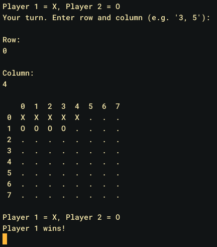

*Spelare 1 vinner med fem i rad på rad 0. Samma meddelande visas hos båda spelarna.*

Om hela brädet fylls utan att någon fått fem i rad blir det oavgjort, och båda spelarna får `Draw!`:

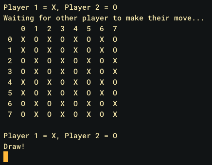

*En match där alla 64 rutor fyllts utan vinnare.*

### Singleplayer
I singleplayer-läget spelar man `O` mot AI:n, som är `X`. Människan börjar. Inmatningen fungerar på samma sätt som i multiplayer, med samma kontroller för ogiltiga drag. När det är AI:ns tur skrivs `AI is thinking...` ut medan minimax-algoritmen söker fem drag framåt. Det tar oftast bara någon sekund per drag. Tidigare var sökdjupet sex drag, men då tog varje drag ungefär en minut eftersom sökträdet växer så snabbt, så djupet sänktes till fem. När spelet är slut skrivs `You win!`, `You lose!` eller `Draw!` ut. Hur det ser ut syns i den andra bilden under Sammanfattning.

### Kända begränsningar
- I singleplayer-läget kontrolleras oavgjort före vinst. Om det sista draget både fyller brädet och ger fem i rad visas därför `Draw!` istället för en vinst. I multiplayer-läget görs kontrollerna i rätt ordning.
- Om en spelare kopplar ner mitt i en match avbryts sessionen på servern, men den andra spelaren får inget meddelande och blir kvar och väntar på ett drag som aldrig kommer.

## Framtagande
### Initial idé
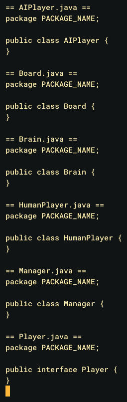

*Den första skissen av arkitekturen (första commiten, mars 2026): tomma klasser för `Board`, `Brain`, `Manager`, `AIPlayer`, `HumanPlayer` och ett `Player`-interface.*

Min första tanke var en klassisk objektorienterad uppdelning, där människan och AI:n var två olika implementationer av ett `Player`-interface och en `Manager` styrde spelet. Jag tog bort den uppdelningen ganska snabbt. Det fanns ingen poäng med att skilja på spelare och AI, eftersom spelloopen ändå bara behöver veta vems tur det är, och en klass som heter `Manager` hade varit dålig namngivning. Istället blev det en `Game`-klass som styr spelet, med `Board` och `Brain` kvar från skissen.

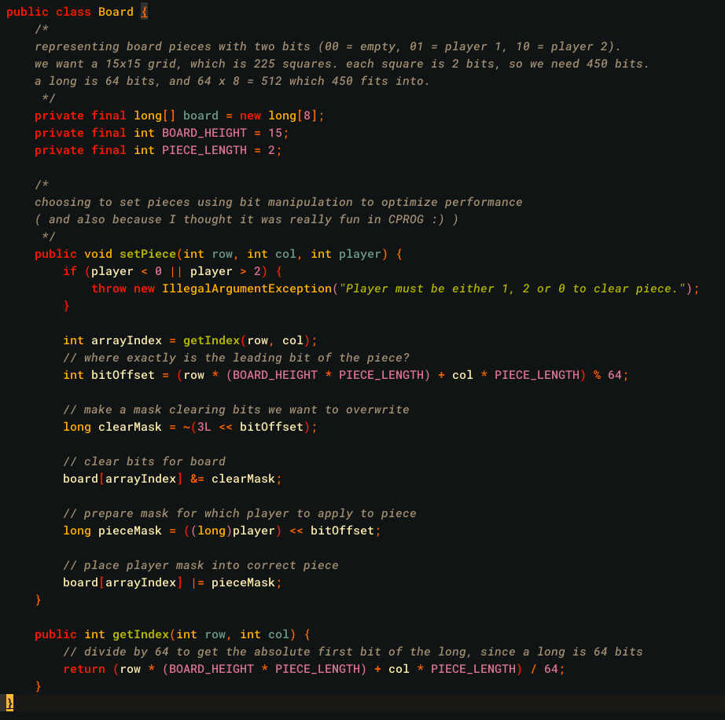

*`Board` och `setPiece()` i en tidig version. Brädet var då hårdkodat till 15×15 och kommentarerna visar uträkningen av hur många `long`-värden som behövs.*

I början tänkte jag använda mig av en vanlig 2d-intarray för att representera spelplanen/brädan \(Board), men eftersom minimax-algoritmen söker så oerhört många olika
game states så valde jag att använda mig av en enda long\[] för att göra varje lookup så snabb och enkel som möjligt. Det gjorde
de egna metoderna för att hämta bitar och sätta bitar lite svårare att skriva, men det var värt för optimeringens skull.

### Implementation av brädlogik
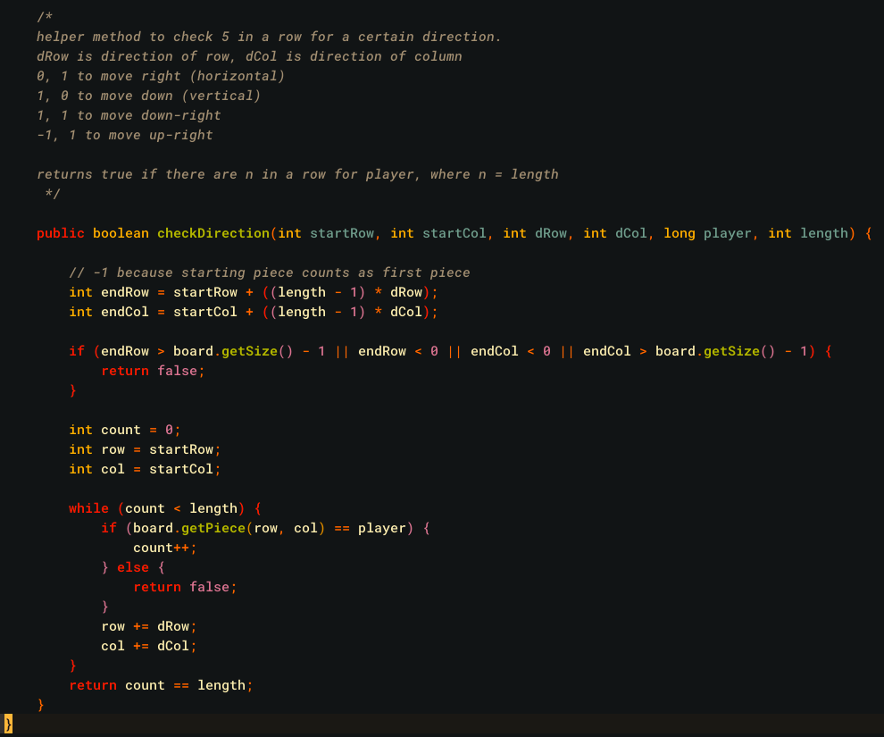

*`checkDirection()` med lathunden för `dRow` och `dCol` som kommentar ovanför metoden.*

Efter den initiala bräd-representationen implementerade jag `checkDirection()` och `checkWinner()` i `Brain`, samt gjorde `Board`
mer generell: storlek och pjäslängd (`size`, `pieceLength`) blev konstruktorparametrar istället för hårdkodade konstanter, och jag
lade till `getLegalMoves()` samt delade upp indexeringen i en publik `getIndex()` och en privat `getInternalIndex()`.
`checkDirection()` skrevs som en enda generell hjälpmetod som tar en riktning (`dRow`, `dCol`) istället för separata metoder för
horisontellt/vertikalt/diagonalt, och `checkWinner()` anropar den i fyra riktningar (höger, ner, ner-höger, upp-höger) för varje
ruta på brädet. 
Det var lite krångligt att komma på att jag skulle generalisera `checkDirection()`-metoden. I början tänkte jag att man skulle ha tre olika `checkDirection()`-metoder:
en för att kolla horisontellt, en för vertikalt och en för diagonala kollar. Snabbt insåg jag att det hade varit mycket smidigare att bara specificera riktning
i metodparametrarna. Det tog en liten stund att komma på hur jag skulle göra att det funkade, men det löste sig till slut. En lathund för hur man använder metoden
ligger som kommentar utanför metoden, mest för att jag själv skulle komma ihåg hur jag tänkte med riktnings-parametrarna (`dRow`, `dCol`).

### Implementation av minimax med alpha-beta-pruning
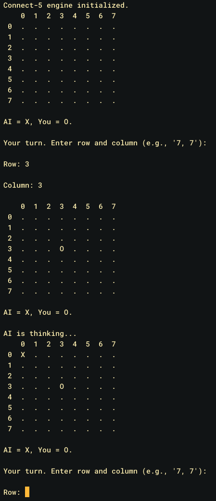

*Den färdiga grundversionen från mars 2026 under körning. Här fanns bara singleplayer, så programmet går direkt in i ett spel mot AI:n utan att fråga om multiplayer.*

Varför jag valde minimax var för att det just var det som lärdes ut under kursen jag gick (ALDA) när grundversionen av programmet skulle implementeras, 
och vi behövde använda den för att få godkänt på uppgiften. Sedan vet jag inte om det finns ett bättre sätt att göra detta på, kanske via någon sorts lookup men 
då hade data behövts insamlas för det vilket jag inte hade tid för.

### Utökning med nätverksfunktionalitet
Det som saknades var att kunna spela med folk, så då valde jag att göra det som mitt Gesällprov. Mellan att den initiala implementationen blev klar (mars 2026) och att nätverksfunktionaliteten byggdes (september 2026) låg det ett uppehåll på ungefär fem månader. Detta eftersom jag hade sommaruppehåll under de månaderna, och inte än hade bestämt mig för att basera IPROG-gesällprovet på Connect5-spelet.

### Uppdelning i client/server/shared
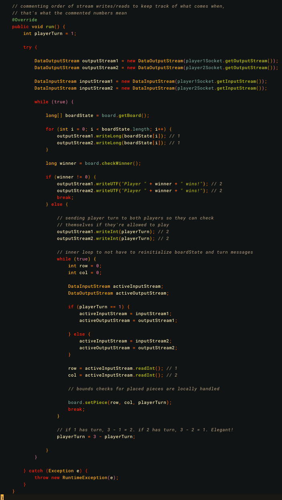

*Matchloopen i den första versionen av `GameSession` (september 2026). Siffrorna `// 1` och `// 2` i kommentarerna är numreringen av läsningar och skrivningar som beskrivs nedan.*

Jag ville mest bara lära mig mer om hur det funkar med client/server-logik, och hur den implementeras i lite större skala. Det innebar att `Game.java` delades upp i en `client`-variant,
att `Server` och `GameSession` skapades från grunden på serversidan, och att `Board`/`Brain` flyttades till ett gemensamt
`shared`-paket som både klient och server använder.

Något som var oväntat svårt med implementeringen var att hålla koll på vilka read/writes som hörde till varandra. Jag behövde numrera 
varje anrop för att hitta ordningen; något som tog upp en större del av den totala arbetstiden än vad jag hade önskat. Annars gick detta ganska smidigt,
och när jag väl hade delat upp allt i klasserna jag ville ha kom resten av koden ganska naturligt.

### Testning och buggfixar
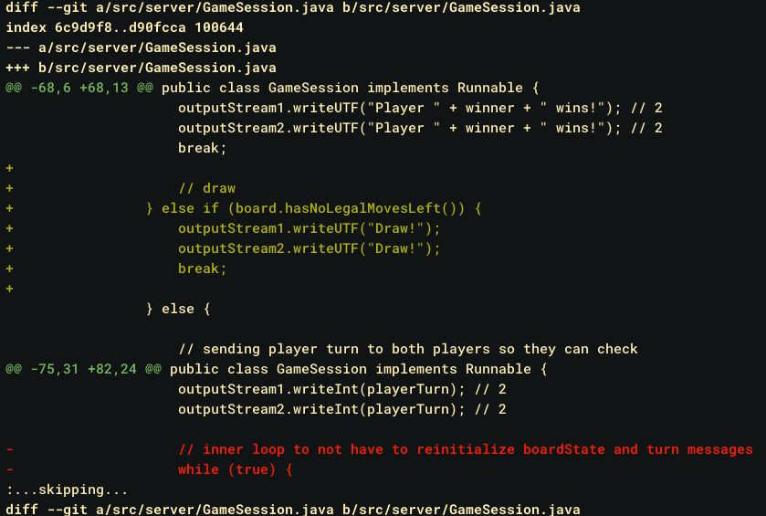

*En del av ändringen i `GameSession` som lade till hantering av oavgjort i multiplayer-läget (oktober 2026). Gröna rader är tillagda och röda är borttagna.*

När jag skrev pseudokoden för beskrivningen gick jag igenom koden steg för steg, och då hittade jag flera brister. Multiplayer-läget hade ingen kontroll för oavgjort, så om brädet blev fullt utan vinnare fortsatte spelet att be om drag som inte gick att göra. En spelare som försökte gå med i ett rum som inte fanns, eller som redan var fullt, fick inget svar alls och blev hängande. Den inre loopen i `GameSession` visade sig också alltid köras exakt en gång, eftersom ogiltiga drag redan stoppas hos klienten, så den togs bort. Till sist upptäckte jag, när jag tog skärmdumparna till den här beskrivningen, att hela servern stängdes av om en klient kopplade ner innan den hade skickat `CREATE` eller `JOIN`. Felhanteringen omslöt hela serverloopen, så den flyttades till att gälla en klient i taget. Alla fyra fixarna testades genom att köra servern och klienterna och spela igenom just de fallen.

## Form

### Paketstruktur
Koden är uppdelad i tre paket: `client`, `server` och `shared`.

- `client` innehåller `Game`, som är spelarens ingångspunkt oavsett om man spelar singleplayer eller multiplayer. Den tar emot inmatning, skriver ut brädet och sköter i multiplayer-läget kommunikationen med servern.
- `server` innehåller `Server`, som tar emot anslutningar och hanterar `CREATE`- och `JOIN`-förfrågningar, samt `GameSession`, som kör en match mellan två spelare i en egen tråd.
- `shared` innehåller `Board` och `Brain`, som används av både klient och server. `Board` håller reda på brädet, vilka drag som är tillåtna och om någon har vunnit. `Brain` är AI:n, som väljer drag med minimax-algoritmen och alpha-beta-pruning. Eftersom klient och server använder samma `Board` finns spelreglerna bara på ett ställe.

### Nätverksprotokoll
Flödet för en multiplayer-match:

1. Klienten ansluter till servern och skickar `CREATE` eller `JOIN`. Vid `JOIN` skickas även rumskoden.
2. Vid `CREATE` skapar servern en ny spelsession med en slumpad rumskod och skickar tillbaka koden. Klienten blir spelare 1.
3. Vid `JOIN` letar servern upp sessionen. Om den finns och inte är full blir klienten spelare 2, båda spelarna får en bekräftelse och sessionen startas i en egen tråd. Annars får klienten ett felmeddelande och avslutas.
4. I varje runda skickar sessionen brädet till båda spelarna.
5. Om någon har vunnit, eller om brädet är fullt, skickas resultatet till båda spelarna och matchen avslutas. Annars skickas vems tur det är.
6. Spelaren vars tur det är skickar sitt drag, servern lägger in det på brädet och nästa runda börjar.

### Hur programmet fungerar i pseudokod 
```code
# Server
sessions start empty

loop

  pause loop until client arrives

  request = getClientOutput()
  if request == "CREATE" then
    roomCode = random six letters
    sessions(roomCode) = new GameSession with matching room code
    send room code to client
   
  else 
      
    if request == "JOIN" then
      roomCode = getClientOutput()
      session = sessions(roomCode)

      if session exists and that session doesn't have a player 2 then
        assign to matching room
        broadcast "Player 2 joined." to both clients
        GameSession(session)&

      else

        send error message to client that tried to join unavailable room

return ""
```


```code
# GameSession

playerTurn = 1

the board starts empty

loop
  send board state to clients

  if there is a winner then
    send winner message to both clients
    exit

  else
    if there is a draw then
      send draw message to both clients
      exit
  
    else
      send playerTurn to both clients
      read row and col variables from player whose turn it is
      set player piece on internal board

  flip playerTurn to other player

return ""
```

```code
# Game

if player wants multiplayer game then 
  startMultiplayerGame()

else
  if player wants singleplayer game then
    startSingleplayerGame()


return ""

# startMultiplayerGame
connect to Server

loop
  ask user if they want to CREATE or JOIN room
  
  answer = user input
  
  if answer == "CREATE" or answer == "JOIN" then
    exit
  else
    show error message

if answer == "CREATE" then
  send "CREATE" to Server
  get room code from Server
  show room code to client terminal

if answer == "JOIN" then
  send "JOIN" to Server
  ask user for room code
  send room code to Server

receive confirmation
show confirmation to user

if confirmation != "Player 2 joined." then
  return ""

loop 
  receive board from GameSession
  print board to client terminal

  if there is winner or draw then
    show result message from GameSession
    exit

  else
    receive whose turn it is
    if it is client's turn then

      loop
        read row and col from user

        if move is valid then
          exit

        else 
          show error message
      send row and col to GameSession

    else
      print that client is waiting for other player to make move

return ""

# startSingleplayerGame
human player starts

loop
  print board
  if there is draw or winner then
    show result
    exit
 
  if it's player's turn then
    loop
      read row and col from player

      if move is valid then
        exit

      show error message

  else
    show AI thinking dialogue
    AI calculates move
  
  set piece to board

  flip player turn
  
return ""
```

