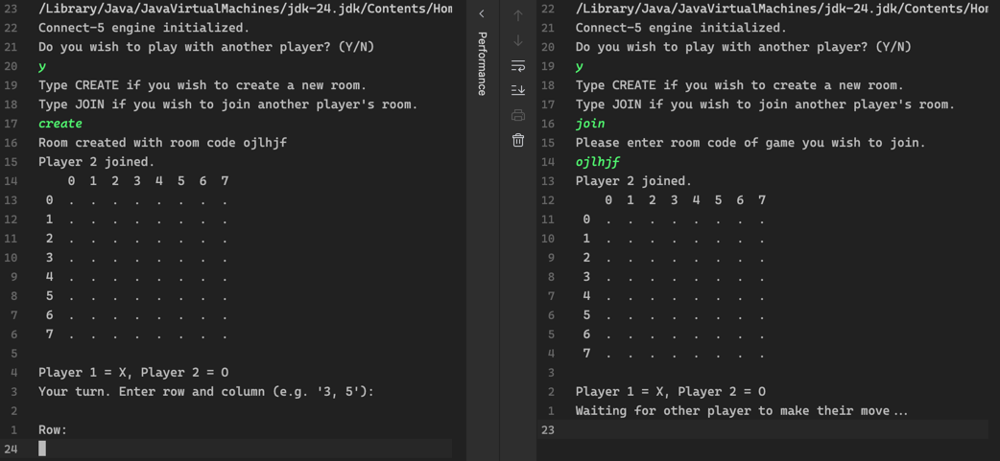
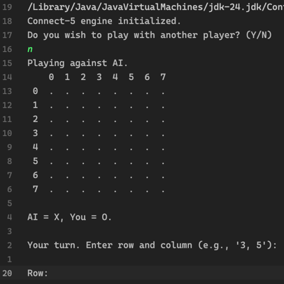

# Gesällprov: Connect 5
## Alexander Herder, alhe5785

## Sammanfattning
Detta är ett enkelt Connect 5-spel (5-i-rad-spel) med både singleplayer- och multiplayerfunktionalitet.
I singleplayer-läget spelas spelet mot en AI som använder sig av minimaxalgoritmen för att
kunna välja bästa draget. I multiplayer-läget kan en spelare starta en "game session" (spelsession).
Varje session kan ha max två spelare, och ett Connect 5-spel kan bara startas om två spelare är anslutna till samma session.
Som spelare kan man också ansluta till någon annans redan startade session genom att skriva in en room code (rumskod) som sessionsstartaren
får utskriven som terminaloutput när en session startas. För att en session ska kunna startas behövs en serverklass köras först, vilket
finns i detta projekt också.

*Hur konsolloutputen ser ut när två spelare möter varandra.*

*Hur konsolloutputen ser ut när en spelare och en AI möter varandra.*

## Framtagande
### Initial idé
I början tänkte jag använda mig av en vanlig 2d-intarray för att representera spelplanen/brädan \(Board), men eftersom minimax-algoritmen söker så oerhört många olika
game states så valde jag att använda mig av en enda long\[] för att göra varje lookup så snabb och enkel som möjligt. Det gjorde
de egna metoderna för att hämta bitar och sätta bitar lite svårare att skriva, men det var värt för optimeringens skull.

### Implementation av brädlogik
Efter den initiala bräd-representationen implementerade jag `checkDirection()` och `checkWinner()` i `Brain`, samt gjorde `Board`
mer generell: storlek och pjäslängd (`size`, `pieceLength`) blev konstruktorparametrar istället för hårdkodade konstanter, och jag
lade till `getLegalMoves()` samt delade upp indexeringen i en publik `getIndex()` och en privat `getInternalIndex()`.
`checkDirection()` skrevs som en enda generell hjälpmetod som tar en riktning (`dRow`, `dCol`) istället för separata metoder för
horisontellt/vertikalt/diagonalt, och `checkWinner()` anropar den i fyra riktningar (höger, ner, ner-höger, upp-höger) för varje
ruta på brädet. 
Det var lite krångligt att komma på att jag skulle generalisera `getDirection()`-metoden. I början tänkte jag att man skulle ha tre olika `getDirection()`-metoder:
en för att kolla horisontellt, en för vertikalt och en för diagonala kollar. Snabbt insåg jag att det hade varit mycket smidigare att bara specificera riktning
i metodparametrarna. Det tog en liten stund att komma på hur jag skulle göra att det funkade, men det löste sig till slut. En lathund för hur man använder metoden
ligger som kommentar utanför metoden, mest för att jag själv skulle komma ihåg hur jag tänkte med riktnings-parametrarna (`dRow`, `dCol`).
[FYLL I: var det svårt att komma på att generalisera till en (dRow, dCol)-metod, eller föll det sig naturligt? Var `checkWinner()`
hårdkodad till 15x15 trots den nya `getSize()`-metoden ett problem i praktiken, eller spelade det ingen roll eftersom brädstorleken
aldrig ändrades under körning?]

### Implementation av minimax med alpha-beta-pruning
Varför jag valde minimax var för att det just var det som lärdes ut under kursen jag gick (ALDA) när grundversionen av programmet skulle implementeras, 
och vi behövde använda den för att få godkänt på uppgiften. Sedan vet jag inte om det finns ett bättre sätt att göra detta på, kanske via någon sorts lookup men 
då hade data behövts insamlas för det vilket jag inte hade tid för.

### Utökning med nätverksfunktionalitet
Det som saknades var att kunna spela med folk, så då valde jag att göra det som mitt Gesällprov. Mellan att den initiala implementationen blev klar (mars 2026) och att nätverksfunktionaliteten byggdes (september 2026) låg det ett uppehåll på ungefär fem månader. Detta eftersom jag hade sommaruppehåll under de månaderna, och inte än hade bestämt mig för att basera IPROG-gesällprovet på Connect5-spelet.
funderade du på lösningen under tiden?

### Uppdelning i client/server/share
Jag ville mest bara lära mig hur det funkar med client/server-logik. Det innebar att `Game.java` delades upp i en `client`-variant,
att `Server` och `GameSession` skapades från grunden på serversidan, och att `Board`/`Brain` flyttades till ett gemensamt
`shared`-paket som både klient och server använder.

Något som var oväntat svårt i att implemnentera detta var att hålla koll på vilka read/writes som hörde till varandra. Jag behövde numrera 
varje anrop för att hitta ordningen; något som tog upp en större del av den totala arbetstiden än vad jag hade önskat. Annars gick detta ganska smidigt,
och när jag v
[FYLL I: vad var svårast med övergången till client/server — protokolldesignen (vad som skickas i vilken ordning), att hantera
flera anslutna klienter samtidigt i `GameSession`, eller något annat som trådsäkerhet/synkronisering? Ett konkret exempel eller
en bugg du stötte på här skulle stärka reflektionen mycket.]

<!--
TODO (2 sidor eller mer, text och bild): beskriv i minst 5 steg hur
utvecklingen från tanke till färdig produkt har skett. Ta med eventuella
skisser på helheten och visa/beskriv hur koden har förändrats under
utvecklingen.

Din git-historik ger en bra utgångspunkt för stegen, t.ex.:
1. Initial idé och arkitektur (bräde som lagras bitvis, spelarklasser)
2. Implementation av brädlogik (setPiece, checkWinner, checkDirection)
3. Implementation av minimax med alpha-beta-pruning för AI-motståndaren
4. Beslut att utöka projektet med nätverksfunktionalitet (klient-server)
5. Uppdelning i client/server/shared-paket, implementation av Server och
   GameSession för multiplayer
(fyll i med egna reflektioner, svårigheter, vägval och varför du gjorde
som du gjorde i varje steg)
-->

## Form

<!--
TODO (2 sidor eller mer, text och bild): beskriv hur koden i det färdiga
programmet är uppbyggd och fungerar. Ta med exempel på centrala
kod-avsnitt samt beskriv hur helheten fungerar med pseudokod.

Tänk på att:
- Beskriva paketstrukturen (client/server/shared) och varför den ser ut så
- Förklara hur brädet representeras (bitpackning i long[]) och varför
- Förklara minimax/alpha-beta-algoritmen på hög nivå
- Förklara nätverksprotokollet mellan klient och server (CREATE/JOIN-flödet,
  vad som skickas i vilken ordning)
- Pseudokoden ska följa syntaxen på länken i uppgiftsbeskrivningen
  (05_ass/final/pseudocode) - skriv den själv utifrån din egen kod,
  inget facit finns med avsikt.
-->

## Funktion

<!--
TODO (2 sidor eller mer, text och bild): beskriv hur det färdiga
programmet fungerar och ser ut under körning.

Tänk på att:
- Visa/beskriv startflödet (singleplayer vs multiplayer-val)
- Visa/beskriv hur en multiplayer-match skapas och joinas (rumskod)
- Visa/beskriv hur ett drag görs och hur brädet uppdateras hos båda spelare
- Visa/beskriv vinst/oavgjort-fallen
- Skärmdumpar av terminalen under körning passar bra här
-->
